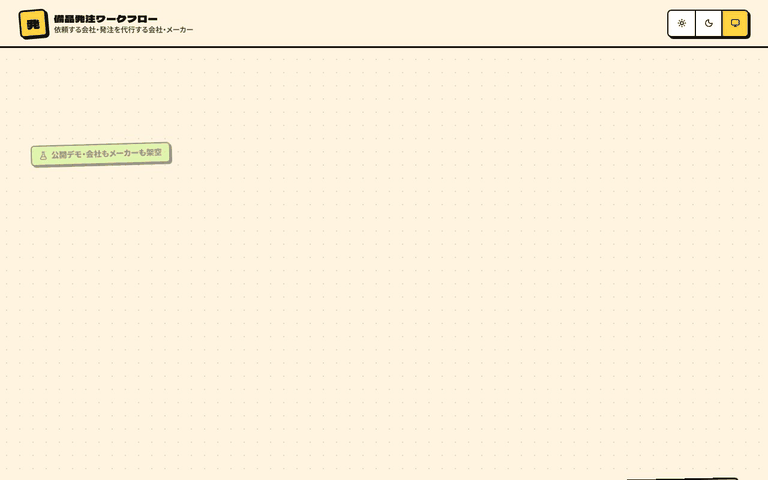
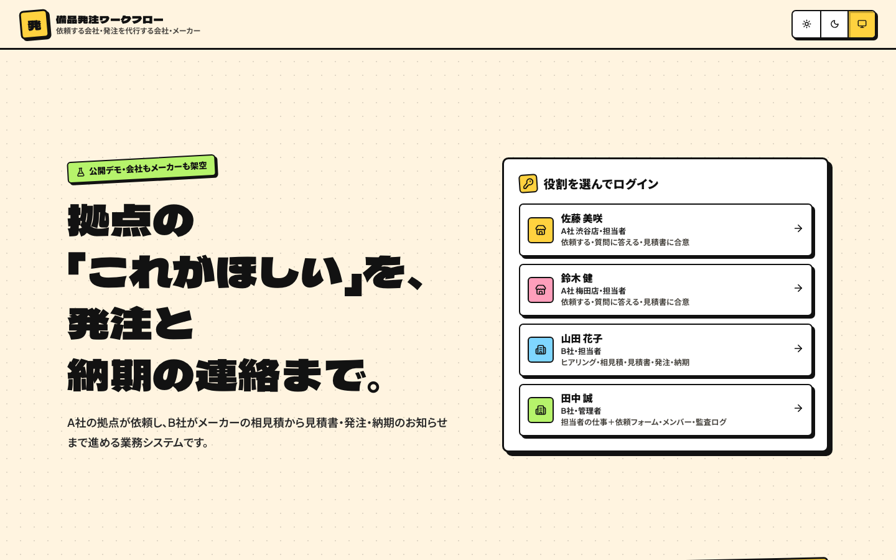
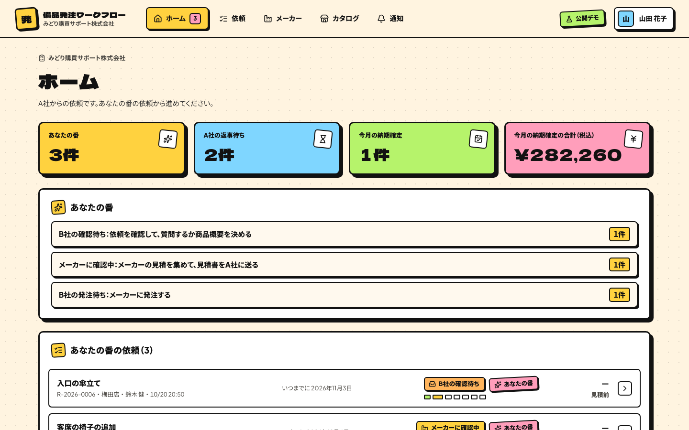
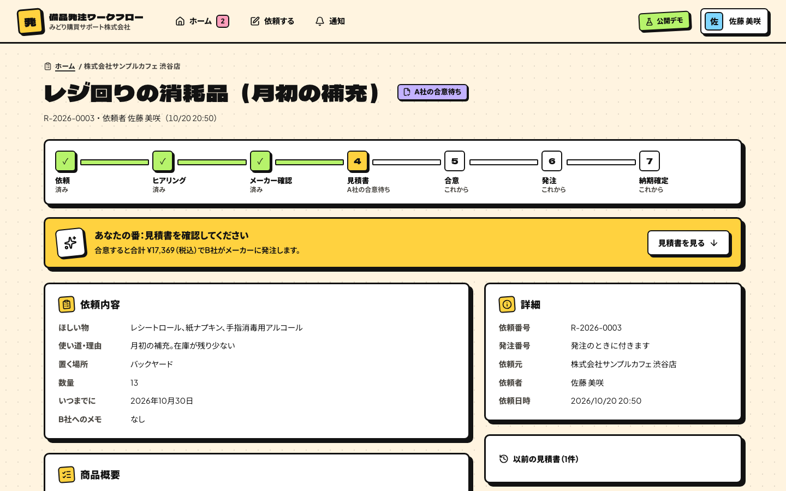
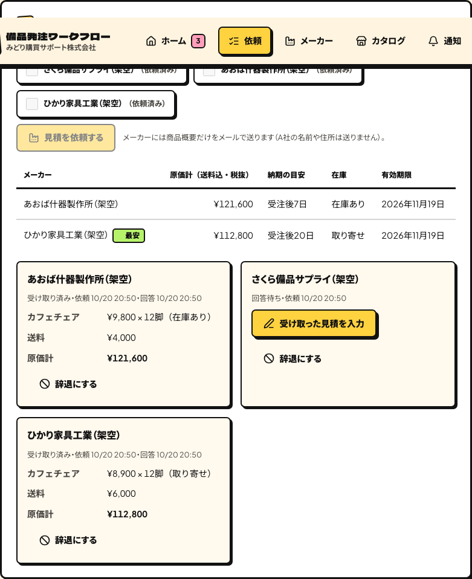
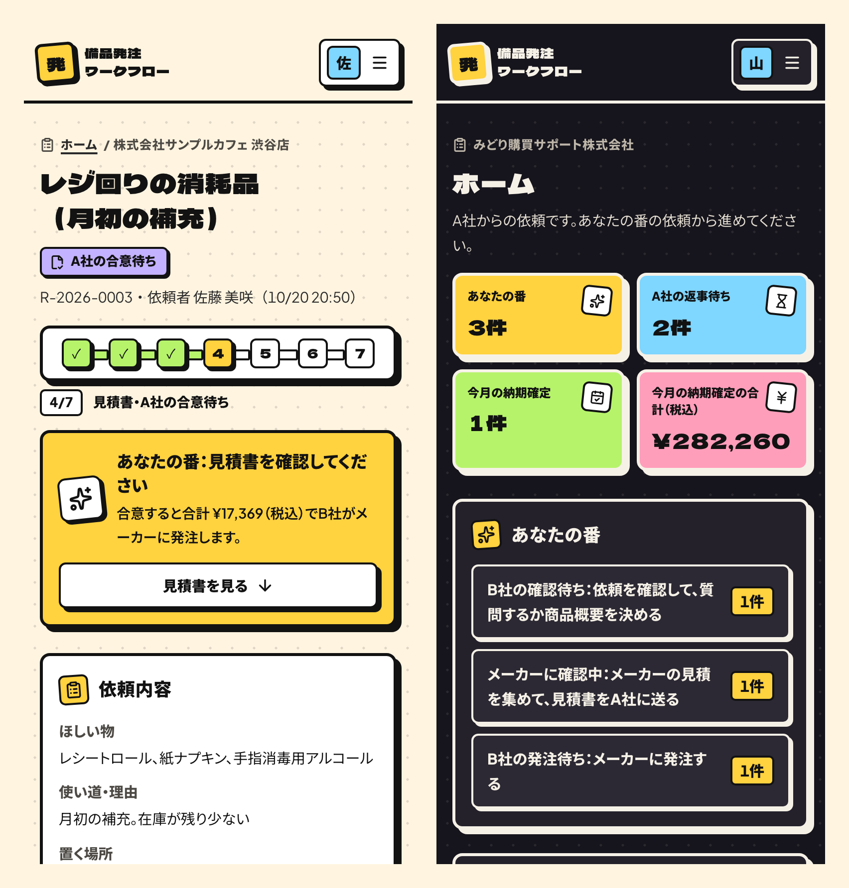
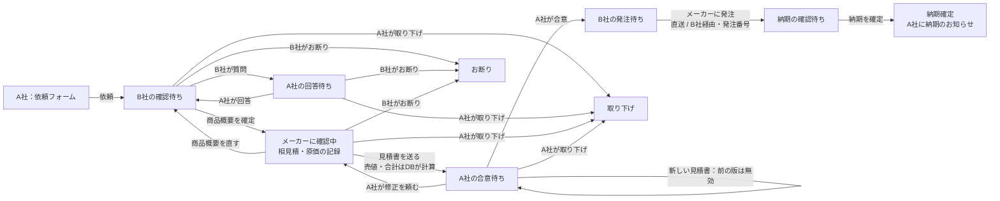

# 備品発注ワークフロー

**A社（店舗をもつ会社）の拠点が依頼フォームで什器・備品を頼み、B社（購買代行）がアプリの中でヒアリングして商品概要を決め、登録メーカーに見積を取り、利益を載せた見積書をA社に出す。A社が合意したらB社がメーカーに発注し、納期を決めてA社に「納期のお知らせ」を届ける業務システム。**

[](https://github.com/Ryou-Koshimizu/japanese-procurement-workflow/actions/workflows/ci.yml)
[](LICENSE)

**公開デモ：<https://japanese-procurement-workflow.vercel.app>**（役割を選ぶだけでログインできます。APIキーや登録は不要です）

会社・拠点・人物・メーカー・商品はすべて架空です。



| ログイン（最初の画面に役割のボタン）                                            | B社のホーム（あなたの番の件数から始める）                                           |
| ------------------------------------------------------------------------------- | ----------------------------------------------------------------------------------- |
|                           |  |
| **A社が見る見積書（売値と合計だけ）**                                           | **B社だけに見える相見積（原価・納期・在庫・最安）**                                 |
|  |                 |



画面はネオブルータリズムの質感です（太い枠線・ずらした影・平塗りの色）。押すと影の分だけ沈み、札が傾いて飛び込み、進み具合が1段ずつ進み、発注を確定すると紙片が弾けます。「視差効果を減らす」設定ではすべての動きを止めます。決めごとは [画面の設計](docs/design.md)。

## 何ができるか

- **依頼フォームを変えられる**：B社の管理者が、A社に聞く項目（ラベル・説明・必須/任意・文字・数値・日付・URL・選択肢）を足す・直す・並べ替える・使わないにできます。A社の拠点はそのフォームで依頼し、未入力や形式の誤りはその場で項目ごとに示します
- **アプリの中でヒアリング**：B社は依頼を見て質問を送り、A社が回答します。電話で聞いたことなどは「B社メモ」に残せ、A社には見えません
- **商品概要 → メーカーの相見積**：B社が品名・仕様・数量を決めて確定し（カタログからも選べます）、登録メーカーの1社または複数社に見積を依頼します。メーカーには商品概要だけを送り、A社の名前や住所は送りません。届いた原価・在庫・納期の目安を入力すると、最安が比べられます
- **原価はA社に見せない見積書**：B社は1社の見積を選び、「原価に率を載せる」か「売値を入力」で売値を決め、送料・諸経費を足して見積書をA社に送ります。A社の画面・API・メールには売値・税額・合計だけが届き、原価・利益・メーカー名・B社メモはデータベースの行単位の権限（RLS）で返しません
- **合意 → 発注 → 納期のお知らせ**：A社は見積書に合意するか、修正を頼むか、取り下げます。合意後、B社は「メーカーから直送」か「B社経由」を選んでメーカーに発注書（発注番号つき）を送り、メーカーに確かめた納期を入れると、依頼した拠点の担当者に「納期のお知らせ」が届きます
- **金額はデータベースが計算**：売値・送料・諸経費・税率ごとの消費税（10%・8%、税率ごとに1回切り捨て）・合計を、B社が選んだメーカーの原価と載せ方からDBが計算します。画面の試算は同じ規則です
- **拠点ごとの分離と監査**：A社の担当者は自分の拠点の依頼だけを見られます。状態の変更・見積・合意・発注・納期はDBのトリガーが監査ログに書き、通知は同じ処理の中で送信予定（outbox）に記録します

## 役割

| 役割                   | できること                                                                                                           |
| ---------------------- | -------------------------------------------------------------------------------------------------------------------- |
| A社 担当者（`client`） | 自分の拠点から依頼する、質問に答える、見積書に合意・修正依頼・取り下げ、納期のお知らせを受け取る                     |
| B社 担当者（`agent`）  | 全拠点の依頼を見る、質問・メモ、商品概要、メーカーへの見積依頼と回答の記録、見積書、発注、納期、お断り、メーカー登録 |
| B社 管理者（`admin`）  | 担当者の作業に加え、依頼フォーム、カタログ、メンバー、監査ログ                                                       |

## 流れと状態



## 実測（2026-10-20、macOS 26.5・Node.js 24.18・Playwright 1.64 で計測）

| 指標                        | 結果                                                                                                                                                                                                                                                                                                                                                                                                                                                                                                                                                                                                                   |
| --------------------------- | ---------------------------------------------------------------------------------------------------------------------------------------------------------------------------------------------------------------------------------------------------------------------------------------------------------------------------------------------------------------------------------------------------------------------------------------------------------------------------------------------------------------------------------------------------------------------------------------------------------------------- |
| 単体・DBのテスト（vitest）  | 14ファイル・127件すべて成功（`RUN_POSTGRES_TESTS=1 npm test`。実PostgreSQLの6件を含み、省略0件）                                                                                                                                                                                                                                                                                                                                                                                                                                                                                                                       |
| 実PostgreSQL 17.11 のテスト | 6件すべて成功。合意の二度押しで合意は1件、合意と再見積の衝突で状態が1つに決まりデッドロックなし、同時の発注で発注番号は1つ、ログイン用ロールは `SET ROLE` なしで何も読めずA社には原価が返らない、デモの初期データ（7つの状態の依頼・23商品・3メーカー）は二重に入らない                                                                                                                                                                                                                                                                                                                                                |
| ブラウザのテスト（E2E）     | Chromium と WebKit でそれぞれ35件、計70件すべて成功。依頼フォーム → 質問 → 回答 → 商品概要2行 → 2社に見積依頼 → 2社の回答を記録 → 原価に20%を載せた見積書 → A社の画面とHTMLに原価・メーカー名が出ないことを確認 → 合意 → 直送で発注 → 納期確定 → A社の「通知」に納期と合計。他拠点の依頼は404、A社によるB社の操作と別サイトからの送信は403                                                                                                                                                                                                                                                                             |
| 実PostgreSQLでの通し操作    | 公開デモと同じ「共有DBのデモ」（`DEMO_DATABASE_URL`）をローカルの PostgreSQL 17.11 につないで、上の70件を Chromium・WebKit で流し、すべて成功                                                                                                                                                                                                                                                                                                                                                                                                                                                                          |
| 画面の大きさ                | 25種類（280×653・320×568・360×640・375×667・390×844・393×852・412×915・430×932・横向き 568×320・667×375・844×390・932×430・600×960・768×1024・820×1180・1024×768・1024×1366・1180×820・1280×720・1366×768・1440×900・1536×864・1920×1080・2560×1440・3840×2160）× ログイン・ホーム・依頼する・通知・依頼一覧・依頼の画面（デモの全件）・メーカー・カタログ・管理者の4画面・見つからない画面で、横のはみ出し0・文字の欠けとはみ出し0・ヘッダー80px・ログインのヒーローが「画面の高さ − 80px」でその中身が最初の画面に収まる・各画面の見出しと主な操作が最初の画面にある（`e2e/responsive.spec.ts`、Chromium と WebKit） |
| アクセシビリティ（axe）     | WCAG 2.1 A/AA の違反0件。ライト・ダークそれぞれで、A社（ホーム・依頼する・見積書の届いた依頼・納期確定の依頼・通知）とB社（ホーム・相見積中の依頼・納期確定の依頼・メーカー・通知）の10画面、Chromium と WebKit                                                                                                                                                                                                                                                                                                                                                                                                        |
| コードスキャン（CodeQL）    | 高リスクの指摘2件（正規表現の先頭固定・HTMLコメントの終わり方）を直し、再発を防ぐテスト14件を追加（`tests/code-scanning.test.ts`）                                                                                                                                                                                                                                                                                                                                                                                                                                                                                     |

## 試す

### 手元で（DB・APIキー不要）

```sh
npm ci
cp .env.example .env.local
npm run dev
```

<http://127.0.0.1:3000> で役割を選んでログインします。プロセス内のPostgreSQL（PGlite）に、架空の会社と7件の依頼（納期確定・合意済み・見積書の回答待ち・相見積中・質問の回答待ち・新規・お断り）が入っています。メールは送らず、画面の「通知」に表示します。パスワードは全員 `demo-password-2026` です。

| ログインの人            | 会社・拠点                    |
| ----------------------- | ----------------------------- |
| 佐藤 美咲（A社 担当者） | 株式会社サンプルカフェ 渋谷店 |
| 鈴木 健（A社 担当者）   | 株式会社サンプルカフェ 梅田店 |
| 山田 花子（B社 担当者） | みどり購買サポート株式会社    |
| 田中 誠（B社 管理者）   | みどり購買サポート株式会社    |

登録メーカー（架空）：さくら備品サプライ（カタログあり）・あおば什器製作所・ひかり家具工業。

1. **佐藤** で「依頼する」からフォームを送る
2. **山田** で依頼を開き「質問を送る」→ **佐藤** で「回答を送る」
3. **山田** で商品概要を書いて「商品概要を確定する」→ メーカーを2社選んで「2社に見積を依頼する」→ 各社の「受け取った見積を入力」
4. **山田** で「原価に率を載せる」を選び「見積書をA社に送る」→ **佐藤** で「合意する」
5. **山田** で「メーカーから直送」か「B社経由」を選んで「メーカーに発注する」→ 納期を入れて「納期を確定してA社に知らせる」
6. **佐藤** の「通知」に【納期のお知らせ】が届く。**田中** で「依頼フォーム」「監査ログ」を確認

### 自分のDBで（実運用モード）

PostgreSQLと、必要ならメール送信用のSMTPを使います。手順は [ローカル実行と実運用モード](docs/local-setup.md)。

## 設計

| 層               | 実装                                                                                                                             |
| ---------------- | -------------------------------------------------------------------------------------------------------------------------------- |
| 権限と業務ルール | [db/schema.sql](db/schema.sql)：RLS、状態遷移を検査するトリガー、見積書の金額の計算（`app.issue_quote`）、採番、監査ログと通知   |
| 業務処理         | [src/server/service/](src/server/service)：すべて `asUser()` で制限ロールとして実行。依頼ごとに行ロックを取ってから変更          |
| 金額の規則       | [src/core/money.ts](src/core/money.ts)：画面の試算。DBと同じ規則でテストしています                                               |
| 通知             | [src/core/notification.ts](src/core/notification.ts)・[src/server/mailer.ts](src/server/mailer.ts)：outboxから送信、失敗は再試行 |
| カタログ         | [src/core/catalog](src/core/catalog)：メーカーのサイトの構造化データ・CSVから商品を取り込み、商品概要で選べます                  |

[要件定義](docs/requirements.md) / [画面の設計](docs/design.md) / [脅威と対策](docs/security.md) / [検証記録](docs/verification.md)

## 開発

```sh
npm run typecheck && npm run format:check && npm test && npm run build
npx playwright install chromium webkit && npm run test:e2e
npm run db:up && RUN_POSTGRES_TESTS=1 npx vitest run tests/postgres.test.ts
```

対応範囲は依頼から納期のお知らせまでです。見積依頼と発注書はメールで送ります。支払い・請求、在庫管理、検収、メーカーのシステムとのEDI・API連携、SSO・多要素認証は、導入先の仕組みに合わせて加える部分です（[導入前に決める条件](docs/freelance-submission.md#導入前に決める条件)）。

## License

MIT。会社・拠点・人物・メーカー・商品・ブランドはすべて架空です。デモのメールアドレスは `example.com` を使い、送信しません。
