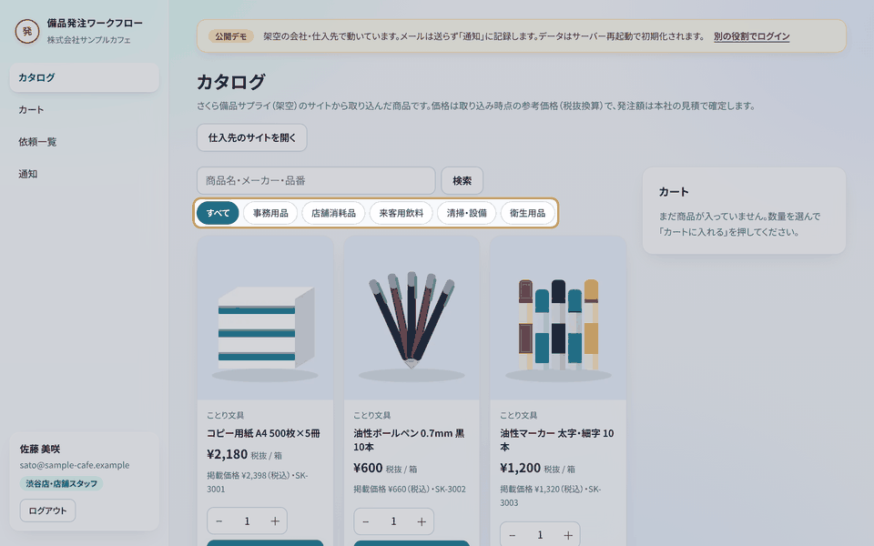
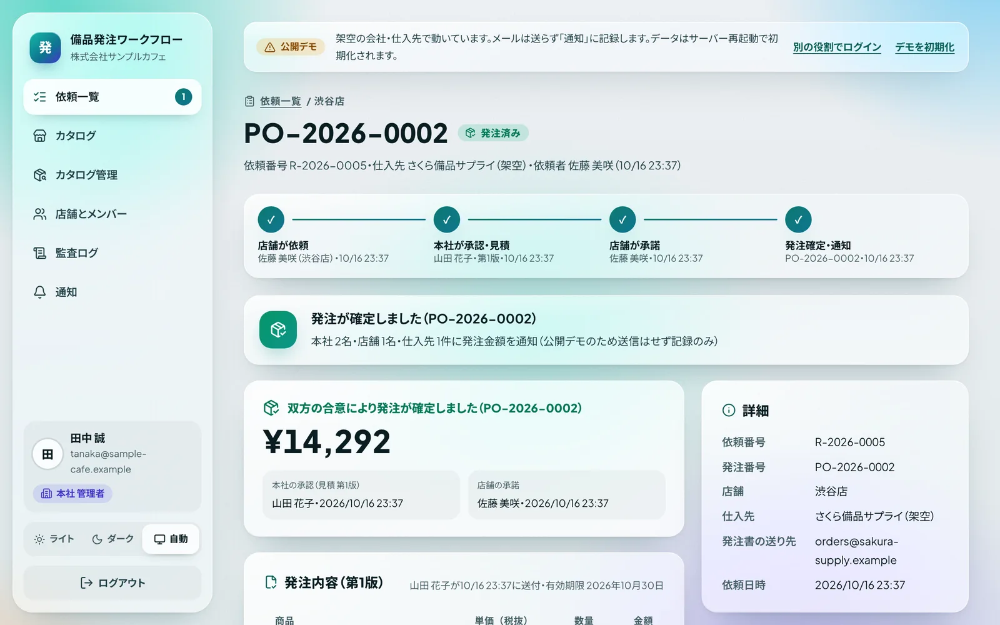
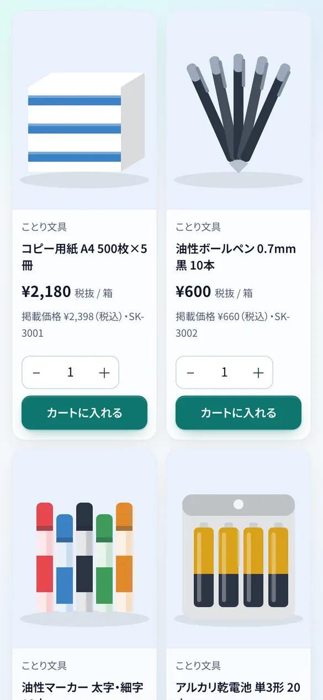
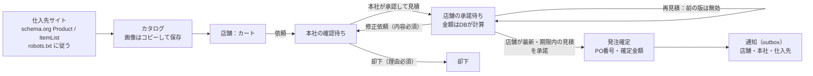

# 備品発注ワークフロー

**仕入先のサイトから商品カタログを取り込み、店舗の発注依頼 → 本社の承認と見積 → 店舗の承諾で双方の合意が取れた時点で発注を確定し、発注金額を店舗・本社・仕入先へ通知する業務システム。**

[](https://github.com/Ryou-Koshimizu/japanese-procurement-workflow/actions/workflows/ci.yml)
[](LICENSE)



上は手元で動かした公開デモの実画面です。会社・店舗・仕入先・商品はすべて架空で、カタログは同梱の架空の仕入先サイトから、実際のサイトと同じ処理で取り込んでいます。

<p>
  
  
</p>

## 何ができるか

- **指定のサイトからカタログ**：仕入先のサイトに載っている商品の構造化データ（schema.org の `Product`・`ItemList`、なければ Open Graph）を読み取ります。商品一覧ページを指定すれば、同じサイトの商品ページを最大60ページたどります。`robots.txt` に従い、1件ずつ間隔を空けて読みます。構造化データのない仕入先はCSV（UTF-8・Shift_JIS）で取り込めます。取り込み直すと価格の変更を反映し、載らなくなった商品は発注できなくなります
- **店舗 → 本社 → 店舗の合意**：店舗はカタログからカートに入れて依頼。本社は内容を確認し、単価・数量・送料・有効期限を決めた見積を送って承認する（または理由を付けて却下）。店舗は見積を承諾するか、修正を依頼するか、取り下げる。本社が再見積すると前の版は無効になります
- **合意で発注・金額を双方へ**：店舗が「最新で期限内の見積」を承諾した、その同じSQL文の中で発注番号（`PO-年-連番`）を採番し、確定した金額を店舗のスタッフ・本社の担当者・仕入先（発注書）への通知として記録します。メールは記録の後に送り、失敗したら再試行します
- **金額はデータベースが計算**：明細・送料・税率ごとの対象額と消費税（10%・8%、税率ごとに1回切り捨て）を、本社が送った単価と数量からDBが計算します。画面やAPIから送られた合計は使いません。画面の試算はDBと同じ規則で、テストで両者を照合しています
- **店舗ごとの分離と監査**：店舗スタッフは自分の店舗の依頼だけ、本社は全店舗の依頼（カートは見えない）を見られます。状態の変更・見積・承諾・カタログの変更はDBのトリガーが監査ログに書きます

## 実測

| 指標                     | 結果                                                                                                                                                                                                    |
| ------------------------ | ------------------------------------------------------------------------------------------------------------------------------------------------------------------------------------------------------- |
| 単体・DBのテスト         | 94件すべて成功。他店舗の依頼の参照、店舗による見積、本社による承諾、見積の金額・明細・発注番号の書き換え、期限切れや置き換えられた見積の承諾、監査ログと通知の偽造が、アプリを通さないSQLでも拒否される |
| 実PostgreSQL 17のテスト  | 6件すべて成功。承諾の二度押しで発注は1件だけ。承諾と再見積を同時に5回ぶつけて、毎回どちらか一方だけが成立しデッドロックなし。ログイン用ロールは `SET ROLE` しない限り何も読めない                       |
| ブラウザのテスト（E2E）  | 7件すべて成功（依頼→見積→承諾→発注確定→双方の通知、他店舗からの参照が404、役割違いの操作と別サイトからの送信が403、修正依頼、再取り込み）。axeでWCAG A/AA違反0件                                        |
| 同梱の架空仕入先サイト   | 一覧1ページ＋商品23ページを読み、23商品・23画像を取り込み（税込表示から税抜の参考単価へ換算、「軽減税率」の表記から8%を判定、在庫切れを発注不可に）                                                     |
| 実在の通販サイトでの確認 | 国内の大手通販サイト2つのトップページで確認：1つはこの取り込みのUser-Agentに403を返し、もう1つはトップページに商品の構造化データがなかった（商品ページは未確認）。読めないサイトはCSVで取り込む前提です |

詳しくは [検証記録](docs/verification.md)。提出・レビュー向けの説明は [業務シナリオと導入条件](docs/freelance-submission.md)。

## 試す

### 手元で（DB・APIキー不要）

```sh
npm ci
cp .env.example .env.local
npm run dev
```

<http://127.0.0.1:3000> で役割を選んでログインします。プロセス内のPostgreSQL（PGlite）に、架空の「株式会社サンプルカフェ」（3店舗と本社）が、取り込み済みのカタログと4件の依頼つきで入っています。

1. **佐藤（渋谷店）** でカタログから商品をカートに入れ、本社に依頼する
2. **山田（本社 購買）** で依頼を開き、単価や送料を直して「承認して見積を送る」
3. **佐藤** で見積を開き「この見積で発注する」→ 発注番号と金額が確定し、「通知」に店舗・本社・仕入先あての通知が並ぶ
4. **田中（本社 管理者）** で「カタログ管理」→「サイトから取り込む」、「監査ログ」を確認

架空の仕入先サイトは <http://127.0.0.1:3000/demo-supplier/> で見られます。デモでは外部には接続せず、このサイトのファイルを同じ読み取り処理で読みます。

### 自分の仕入先・自分のDBで（実運用モード）

PostgreSQLと、必要ならメール送信用のSMTPを使います。手順は [ローカル実行と実運用モード](docs/local-setup.md)。

## 設計



| 層                 | 実装                                                                                                                                              |
| ------------------ | ------------------------------------------------------------------------------------------------------------------------------------------------- |
| 権限と業務ルール   | [db/schema.sql](db/schema.sql)：RLS、状態遷移と見積を検査するトリガー、金額の計算、採番、監査ログと通知を書くトリガー                             |
| カタログの読み取り | [src/core/catalog](src/core/catalog)：JSON-LD・Open Graph・CSV・robots.txt。[src/server/importer.ts](src/server/importer.ts)：巡回と画像          |
| 外部への接続       | [src/server/net.ts](src/server/net.ts)：社内・ローカルのアドレスへの接続拒否（接続時にDNSの答えを検査）、リダイレクトの再検査、大きさと時間の上限 |
| 業務処理           | [src/server/service.ts](src/server/service.ts)：すべて `asUser()` で制限ロールとして実行                                                          |
| 通知               | [src/server/mailer.ts](src/server/mailer.ts)：outboxを `SKIP LOCKED` で取り出して送信、失敗は間隔を空けて最大5回                                  |

判断の記録：[DBで業務ルールを強制](docs/adr/001-database-enforced-workflow.md) / [双方の合意＝現在の見積の承諾](docs/adr/002-two-party-agreement.md) / [構造化データでカタログを読む](docs/adr/003-catalog-from-structured-data.md) / [通知はoutboxから](docs/adr/004-transactional-outbox.md) / [外部に接続しない公開デモ](docs/adr/005-demo-without-network.md) / [脅威と対策](docs/security.md)

## セキュリティ

- 権限・店舗の分離・状態遷移・金額・監査ログ・通知はデータベースで強制し、アプリは制限ロールでのみ接続します（[脅威と対策](docs/security.md)）
- 仕入先のURLの取り込みは、社内ネットワークやクラウドのメタデータへの接続（SSRF）を拒否し、画像は先頭バイトで形式を確かめてからコピーします（SVGは受け付けません）
- CSP・HSTS等のセキュリティヘッダー、Originの検査、ログイン試行の制限、本文の大きさの上限
- GitHub ActionsはコミットSHAで固定し最小権限。CodeQL・Dependabot・依存関係の審査・Secret scanningを有効化

脆弱性の報告は [SECURITY.md](SECURITY.md) の手順で非公開でお願いします。

## 開発

```sh
npm run typecheck && npm test && npm run build
npx playwright install chromium && npm run test:e2e
npm run db:up && RUN_POSTGRES_TESTS=1 npx vitest run tests/postgres.test.ts
npm run supplier:build   # 架空の仕入先サイトと商品画像を作り直す
```

対象外：支払い・請求、在庫管理、納品と検収、予算や金額による承認段階、仕入先システムとのEDI・API連携、SSO・多要素認証。[要件定義](docs/requirements.md) に状態を記載しています。

## License

MIT。会社・店舗・人物・仕入先・商品・ブランドはすべて架空です。架空の仕入先サイトは予約済みのドメイン `sakura-supply.example` を名乗り、デモはそこに接続しません。商品の絵はこのリポジトリのスクリプトで描いたものです。
